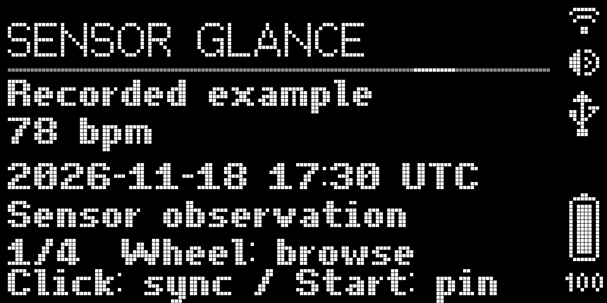

# Sensor Glance

Read your watch at the edge of a monitor during a call or game. Each page includes the sensor’s latest value and timestamp. Heart rate can arrive directly over Bluetooth. Stress, oxygen saturation and VO₂ max use measurements your watch or integration has already recorded.

## Screen transitions

Move from heart rate to stress, oxygen saturation and the last VO2 max estimate. Each reading carries its own unit.


<details>

<summary>Watch the rear display</summary>



</details>

## Setup

For a heart-rate broadcast, install `companion/requirements-ble.txt` in a virtual environment. On a compatible Garmin watch, enable **Broadcast Heart Rate** in the wrist heart-rate settings. Allow Bluetooth access on the companion computer. Use `{"bluetooth_name":"YOUR ADVERTISED DEVICE NAME"}` as config. For other measurements, open Home Assistant **Developer tools → States**, find each entity, and copy its actual ID into `entities`. Remove entries your device does not supply. Set `home_assistant` to your instance, create a long-lived access token in your Home Assistant profile and put it in `HA_TOKEN`. Both inputs can be used together. Direct HR needs the standard Bluetooth Heart Rate Service. An ANT+-only broadcast requires a separate receiver integration.

From the repository root, copy the example and start the companion with Python 3.10 or newer.

```sh
cp companion/example.json config.json
# Edit config.json for your source before starting the server.
python3 companion/serve.py --config config.json
```

In the emulator, run `~/.busy-emulator/bin/busy-emulator allow-local 8770` and approve that port. Open **Apps → Sensor Glance → Setup**, set **Local companion URL** to `http://127.0.0.1:8770/reading`, save, then reopen the app. For a physical bar, start the companion with `--host YOUR_LAN_IP` and replace `127.0.0.1` with that address. Bind only to your trusted network. Open `/reading` on the host to inspect the current reading. Keep credentials in the host environment.

## Watch heart rate and stress

Start broadcasting or sync your configured sensor. Read HEART RATE on the front. Turn the wheel to STRESS and check the timestamp on the rear. If the Bluetooth packets stop for twelve seconds, the heart-rate page reads Waiting.


## Check the date of an estimate

Turn through OXYGEN to VO2 MAX. Check the observation date before comparing sessions. Home Assistant timestamps are entity updates. For VO₂ max the displayed value is the most recent estimate. A source past its freshness threshold reads Stale. Override thresholds by metric in `max_age_seconds` if your integration updates at a different interval.


## Run in the emulator

Install BUSY Bar Emulator and open it. From this repository run the following command, then press **Back** when you finish.

```sh
~/.busy-emulator/bin/busy-emulator dev --once
```

The recordings use example responses on emulator firmware. Each LED occupies a 16 × 16 cell with a black border.

[Home Assistant REST API](https://developers.home-assistant.io/docs/api/rest/) · [Garmin heart-rate broadcasting](https://support.garmin.com/).

[Rear display](screenshots/back-1.png) · [MIT license](LICENSE)
